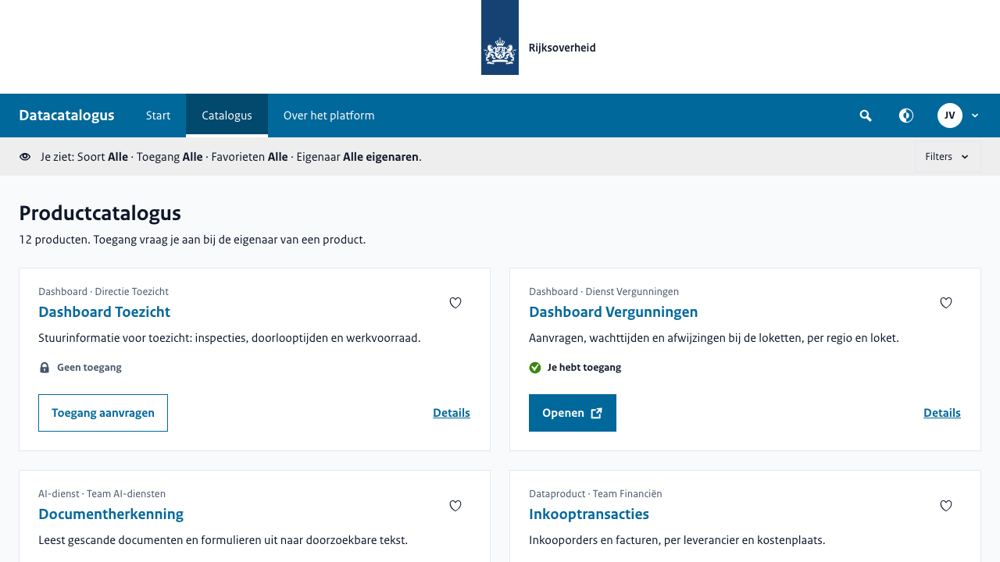
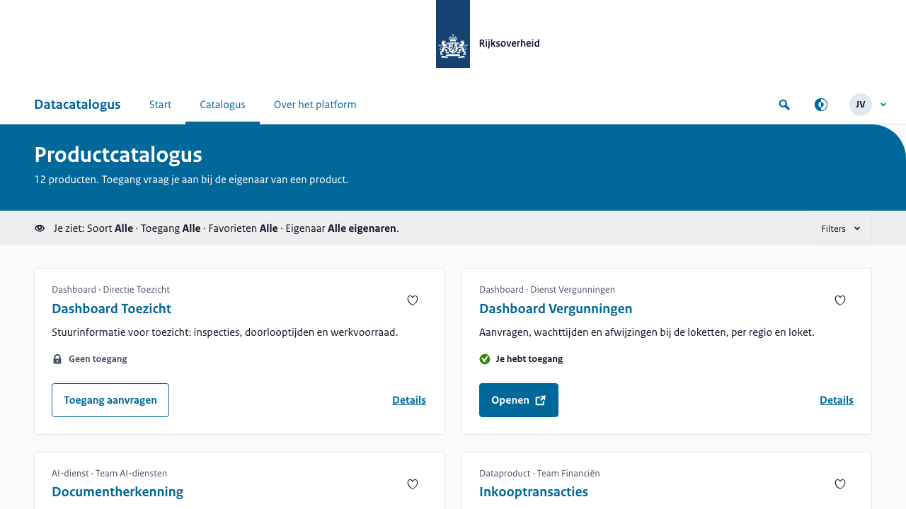
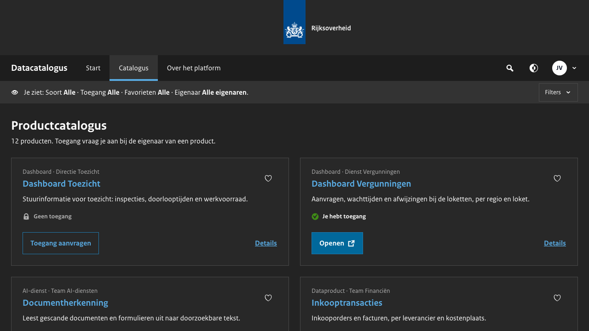
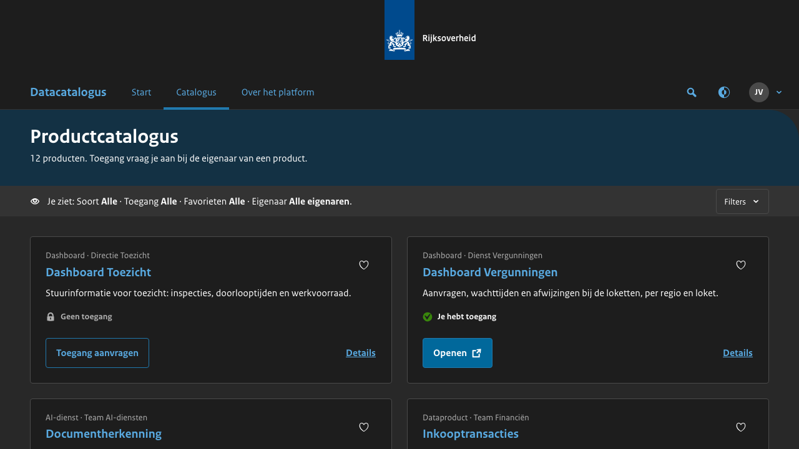

# Tokens, thema's, modus en het embleem

## `tokens.css`

Eén bestand dat het bouwen oplevert: de thema's, dan de tokens. Het moet op de *pagina* staan: de thema's
zijn op documentniveau. Het is ook waarmee je eigen inhoud zich opmaakt:

```css
body {
  margin: 0;
  background: var(--color-bg-page);
  color: var(--color-text-primary);
  font: var(--text-ui);
}
```

**Het bestand is niet optioneel.** De variabelen van het thema staan alleen daar, dus zonder het bestand heeft een
element geen primaire kleur.

## Het lettertype

RijksSans komt uit de set van RVO (`@nl-rvo/assets`). `fonts.css` bevat de twee `@font-face`-regels
en noemt de twee bestanden in `fonts/` ernaast, waar het bouwen ze neerzet. Serveer `fonts/` met
`fonts.css` en link het op de pagina; een pagina zonder tekent in het reservelettertype van `--font-ui`.

## Het thema

Eén attribuut op het document: `<html data-theme="marine">`. Een pagina die er geen zet, krijgt
`rijksoverheid`. De bibliotheek draagt er zes: `rijksoverheid`, `marechaussee`, `landmacht`,
`marine`, `luchtmacht`, `defensie`.

**Een eigen thema is één regel in je eigen stylesheet**, na `tokens.css`:

```css
[data-theme='mijn-organisatie'] {
  --primary: #01689b;
  --accent: #e17000;
}
```

Die twee zijn alles wat een thema zet; de kleur bij aanwijzen, lijnen en tinten worden afgeleid. In donker krijgen lijnen
en tekst een lichtere tint van de primaire kleur, afgestemd op de zes thema's die de bibliotheek draagt; een
eigen thema is niet getoetst aan de ondergrenzen van Lintje.
[`../DESIGN_SYSTEM.md`](../DESIGN_SYSTEM.md) zegt waarom.

De afgeleide kleuren gebruiken `color-mix()` en relatieve kleur (`oklch(from …)`): Chrome/Edge 122+,
Firefox 128+, Safari 18+.

## De huisstijl: oud en nieuw

De Rijkshuisstijl tekent online sinds 2025 anders dan eerst. Lintje tekent beide, en jij kiest met
een attribuut op `<html>`. Elk element spiegelt het op zijn eigen host, zoals `data-mode`, dus de
keuze geldt voor de hele pagina, ook in shadow roots en iframes die het attribuut overnemen.

| attribuut | waarden | zonder attribuut |
|---|---|---|
| `data-style-version` | `classic` (oud) · `new` (nieuw) | `classic`, tot 1.0.0 |
| `data-style-new-corner` | `round` · `square` | `round`; alleen van betekenis bij `new` |

```html
<html lang="nl" data-mode="light" data-style-version="new">
```

**Tot 1.0.0 is de oude huisstijl de standaard.** Een pagina die Lintje bijwerkt zonder
`data-style-version` te zetten, ziet er dus uit zoals eerst. Bij 1.0.0 wordt `new` de standaard;
wie dan de oude wil houden, zet `data-style-version="classic"`.

| Oud (`classic`) | Nieuw (`new`) |
|---|---|
|  |  |
| **Oud in donker** (`data-mode="dark"`) | **Nieuw in donker** (`data-mode="dark"`) |
|  |  |

Wat de nieuwe huisstijl anders tekent:

- **Het menu is wit**, met de woorden in de primaire kleur, en de kop van de pagina wordt de band
  in de primaire kleur, van rand tot rand en recht: de huisstijl rondt nooit een vlak dat van de
  pagina afloopt. Een filterbalk staat onder die kop. Wil je het menu toch gevuld, of in de oude huisstijl licht, zet
  dan zelf `nav-tone="filled"` of `nav-tone="light"` op `lintje-shell`.
- **Kleine ronde hoeken** (4 px) op knoppen, velden, het vinkje en de chips. Een omkaderd blok
  (een kaart, een tegel, een dialoog, een melding) en de voet zijn recht, zoals de huisstijl ze
  tekent. De grote hoek (een lint, 48 px) staat op een lade, die van de rand van het venster komt,
  en op een band met `narrow`, die binnen de marges staat; `data-style-new-corner="square"` laat
  hem weg.
- **De focusring** is een donkere lijn met een witte lijn erin, in plaats van oranje.
- **Het kruimelpad** toont alleen de niveaus boven de pagina, elk een link: het laatste item zonder
  `href`, de pagina zelf, laat het weg. Je geeft hetzelfde pad door als in de oude huisstijl.
- **Een formulierveld** heeft een rand van 1 px in de primaire kleur, zoals de huisstijl een veld in
  lintblauw tekent, en toont zijn toelichting en zijn fout boven het veld, met een rode balk
  ernaast en het veld in de fouttint; de select heeft het pijlvak in de primaire kleur.
- **Een melding, toast of foutsamenvatting** heeft een balk links en een gekleurd icoon.
- **De tertiaire knop** is een woord in de primaire kleur zonder kader; de uitklapper is een
  accordeonrij met lijnen, de dialoog heeft de knoppen links en geen lijnen, de paginering een
  lichte tint, het submenu een vulling.
- **De pagina** heeft de schaal en de marges van de huisstijl: een paginatitel van 32 px, inhoud
  tot 1280 px, een lint marge, vier kolommen op een telefoon, waarvan een item er met
  `span-mobile` minder neemt ([de indeling](start.md#de-indeling-van-een-pagina)).
- **In donker** is het oppervlak het donkerst en de pagina een stap lichter, het spiegelbeeld van
  licht.

Laat je de lezer kiezen, dan biedt "Weergave" van `lintje-shell` de keuze als je `style` (en voor de
hoek `corner`) in zijn `view` zet. Een keuze komt binnen als `lintje-view-change` met `{ style }` of
`{ corner }`; jij zet daarna het attribuut, zoals bij de modus:

```js
shell.addEventListener('lintje-view-change', (event) => {
  const { style, corner } = event.detail
  if (style) document.documentElement.dataset.styleVersion = style
  if (corner) document.documentElement.dataset.styleNewCorner = corner
})
```

In de voorbeelden reist de keuze mee in de URL: `?style=classic` en `?corner=square`
([`../../examples/_shared/settings.js`](../../examples/_shared/settings.js)). De voorbeelden openen in
de nieuwe huisstijl.

## Modus

Elk element bepaalt hem zelf, en de eerste stap die iets zegt, wint: zijn eigen `mode`-attribuut;
de dichtstbijzijnde voorouder met `data-mode`, over shadow roots heen; `mode` in zijn `data`;
dan `light`.

Het gewone geval is één regel: `<html data-mode="dark">`. Een element
leest `prefers-color-scheme` nooit zelf. Om het systeem van de lezer te volgen, zet je het attribuut
vanuit script, voordat de pagina voor het eerst getekend wordt:

```js
const dark = matchMedia('(prefers-color-scheme: dark)')
const apply = () => (document.documentElement.dataset.mode = dark.matches ? 'dark' : 'light')
dark.addEventListener('change', apply)
apply()
```

`data-mode` bevat altijd alleen `light` of `dark`. `lang` is het
gewone HTML-attribuut; geen element leest het, dus zet `lang="nl"` voor schermlezers en woordafbreking.

## Het embleem

De `data` van de shell heeft er twee velden voor, en `logo` wint.

- **`logo`** — een URL of data-URI die je zelf hebt bepaald, getekend als afbeelding.
- **`emblem`** — `{ name, label, byline? }`, op iconbestandsnaam: `name` is het lint, `label`
  de naam van de organisatie, geschreven als tekst naast het lint in de logobalk, en `byline` een
  tweede regel eronder. De bestanden zijn de `embleem-*` in `dist-icons/`.

Zonder een van beide houdt de shell op die plek een leeg vak van de juiste maat.

**Teken een Rijkshuisstijl-embleem nooit na en benader het nooit.** Zonder het bestand lever je de lege plek.
